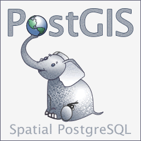
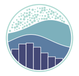
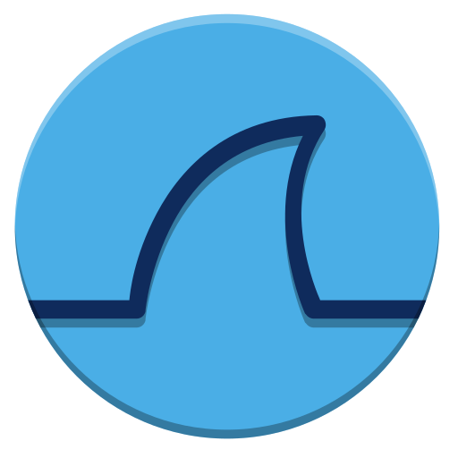
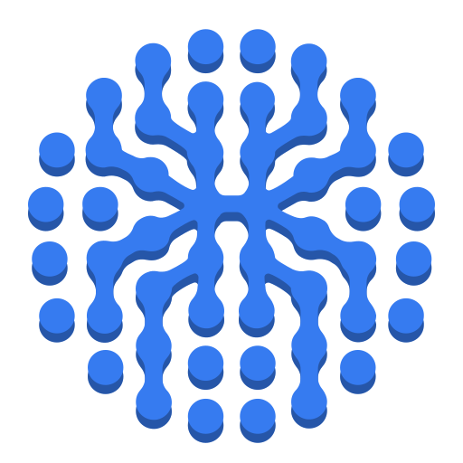

### Software Engineering Student @ INSAT, Tunisia 🇹🇳

**Browser Automation · Applied AI · Geospatial Systems · Software Products**

---

## 🧩 About me

I enjoy turning ideas into working software — from developer tools and backend services to geospatial AI and experimental systems.

I'm especially interested in **what happens under the hood**: process relationships, data pipelines, agent runtimes, system failures, and the trade-offs behind architecture decisions.

I focus on understanding codebases deeply, diagnosing root causes, making sound architecture decisions, and implementing critical components with increasing independence.

> **Build it. Trace it. Understand it. Improve it.**

## 🚀 Selected projects

| Project | What it's about | Status |
| :-- | :-- | :-- |
| [**PhantomLLM**](https://github.com/Medmas07/PhantomLLM) | Multi-provider LLM browser automation with a CLI and OpenAI-compatible HTTP API | Experimental · Open source |
| [**HeatAnalysis AI Pipeline**](https://github.com/Medmas07/HeatAnalysis_Ai_pipeline) | Geospatial workflows for urban heat analysis | Research / prototype |
| [**El-Morched**](https://github.com/Medmas07/El-Morched) | Flood and urban heat risk exploration with geospatial and AI components | Hackathon project |
| [**CAPchat**](https://github.com/Medmas07/CAPchat) | Distributed chat exploring the CAP theorem, divergence and recovery | Educational · Complete |
| [**Veralyze**](https://github.com/Medmas07/Veralyze) | Evidence-first verification of social and web content | Team project / fork |
| [**Campus Scheduling in Prolog**](https://github.com/Medmas07/Campus-Resource-Scheduling-System-Prolog) | Constraint-based university timetable generation | Educational · Complete |

### 🔬 Behind the scenes

Some work is private or still being researched:

- **CognitiveTrace** — multimodal behavior collection and analysis (research in progress).
- **Olive Orchard Segmentation** — Sentinel-2 imagery, U-Net baselines, spatial evaluation (private experiments).

## 🛠️ Technical toolbox

*Tools I have worked with across projects — not a claim of expertise in every technology.*

### Languages

### Web, backend & APIs

### Data, geospatial & infrastructure

Also: virtual machines, network routing architectures, Windows Server, Google Earth and Google Cloud geospatial workflows.

### AI, ML & experimentation

Also: Pandas · statistical visualization · reproducible experiments

### Browser automation & web scraping

I have strong practical experience with browser developer tools for inspecting network traffic, debugging web applications, understanding browser behavior, and building resilient scraping workflows.

### Robotics & embedded systems

### Cybersecurity exploration

Wireshark · Nmap · Zenmap · OpenVPN · pfSense · Tailscale · Burp Suite · Shodan

THC Hydra · SpiderFoot · recon-ng · WPScan · Gobuster · ffuf

## 🌱 Current focus

- Making **PhantomLLM** more reliable and easier for developers to use.
- Advancing **CognitiveTrace** research and reproducible ML experiments.
- Shipping and validating useful software rather than only building prototypes.

## 📊 GitHub activity

## 🤝 Let's connect

Open to conversations about **developer tooling, backend systems, applied AI, research, and open-source collaboration**.

- [GitHub — @Medmas07](https://github.com/Medmas07)
- [LinkedIn — Mohamed Masmoudi](https://www.linkedin.com/in/mohamed-masmoudi-07bb61244/)
- [LeetCode — @contmed](https://leetcode.com/u/contmed/)

---

